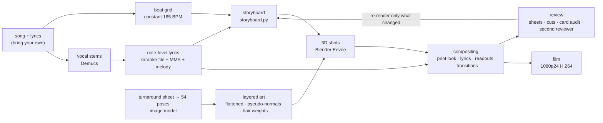

<p align="center">
  
</p>

<h1 align="center">MeltDown</h1>

<p align="center">
  <b>The complete production of a fan music video for 《炉心融解》 (Roshin Yuukai, "Meltdown")</b><br>
  Sets, cameras, effects and lyric typography are all code; image generation is used only for Kagamine Rin's layered character art.
</p>

<p align="center">
  <a href="README.md">中文</a> · English
</p>

<p align="center">
  
  
  
  
</p>

<p align="center">
  music iroha(sasaki) · lyrics kuma · vocal Kagamine Rin<br>
  MV <b>RepressedAlliance (压抑同盟)</b> × <b>Claude</b>
</p>

---

## The film

<table>
  <tr>
    <td width="33%"></td>
    <td width="33%"></td>
    <td width="33%"></td>
  </tr>
  <tr>
    <td align="center"><sub>Opening: one take from the title in through her window</sub></td>
    <td align="center"><sub>Chorus: the reactor's light burns through the page</sub></td>
    <td align="center"><sub>Bridge: the TV host is Rin too</sub></td>
  </tr>
</table>

**Watch:** [YouTube](https://youtu.be/w0tWFyW-kn4) · [Bilibili](https://www.bilibili.com/video/BV19mxr6rEhL)

## What it is

《炉心融解》 is about someone awake at 2 a.m. who wants to dive into a fusion reactor. In this MV, Kagamine Rin carries the "reactor" burning in her chest all the way into a real reactor core. A readout in the corner climbs from the first frame to a hundred million degrees and overflows; after dawn it falls back to 36.5 ℃. The reactor was her own body heat.

5:29, 75 shots:

- **54 3D shots**: a six-mat room, the city at night, a tokamak core, dusk streets, gears. Every set is built procedurally by Python scripts in Blender and rendered with Eevee.
- **16 2D shots** drawn directly with skia (a wall of TVs, a musical score, title cards), plus 5 shots recut from 3D renders, such as the bridge montage that cuts faster and faster.
- **An opening in one take**: the title's ring becomes the reactor's ring, the camera lifts on the drums as the whole night city opens up, flies across the bay and in through one window high in her tower, and comes to rest above her, lying awake. The city and the room are two sets joined into one shot by a single camera path.
- **One print look over everything**: every frame is treated as a small-run spot-colour print, with halftone dots, misregistration and paper grain. In the choruses the reactor's light burns through the page.
- **Lyrics on the note**: every character appears when it is sung, in six typographic styles (vertical, chorus slams, echoes, a TV caption bar, bubbles, a score).
- **Kagamine Rin**: 54 poses and expressions as layered cut-outs, one of her own for every shot. They are placed in the 3D sets as cards and relit there; she breathes and blinks, her hair moves, and in places she acts on the music's accents (climbing stairs, striking a lighter, sinking to the floor, swinging her feet, waving, flinching, waking), as stop-motion between drawings.

This is not a one-click MV template. It is the whole production of one film: follow its methods for your own MV, or take any of its tools on their own.

## Tools you can take

| Tool | What it does | Where |
|---|---|---|
| Note-level lyric alignment | Places every mora of a Vocaloid song on the 16th-note grid. A karaoke file timed by ear is the main reference; acoustic letter probabilities, onsets and the melody pin each one to its exact note | `src/analysis/` |
| Lyric audits | Whole-song checks: characters inside held notes, lines that vanish while the voice continues, line starts against LRC files; a frame-by-frame simulation of how every line appears, leaves and is laid out | `src/tools/audit_lyrics.py`, `qc_lyrics.py` |
| 2D character card shader | Makes a flat drawing sit in a 3D set: a thin rim light from pseudo-normals, a broad key-light gradient that never cuts a new shadow across the drawing, blink by image swap, hair that sways by weight, breathing | `src/blender/character.py` |
| Seating a flat character | An upright card of a drawing touches the bed only at her toes. Sliding the bottom of the card back along the camera's rays leaves the picture unchanged but puts her seat on the quilt, in a hollow the mattress makes, with a contact shadow laid on the cloth | `seat_card` in `src/blender/bedding.py` |
| Card integrity audit | Projects every opaque pixel of each card through the camera: what hides it, whether the drawing's own canvas edge shows on screen, how far it floats above the surface below | `src/tools/card_audit.py` |
| Character processing | Generated art to layers: clean alpha, cel flattening, pseudo-normals, rim band, hair sway weights; widening a canvas that cuts a limb; restaging a replacement pose by its eyes | `src/char/` |
| Procedural sets | A low solid-wood bed (posts, rails, a slatted headboard), a cloth-simulated quilt tucked over a body or spread for sitting, a sewn and inflated pillow, the room, a city, a tokamak, a gear train | `src/blender/` |
| Print-look compositing | AM halftone, spot inks, misregistration, paper, the chorus burn-through | `src/comp/printlook.py` |
| Glyph typography | Japanese vertical setting from font outlines, per-character deformation and melting | `src/typo/glyphs.py`, `src/comp/typo_fx.py` |
| Review tools | Labelled one-frame-per-second review sheets (no encoding, the whole film in minutes), frames around every cut, a check that a drawing's canvas edge never shows on screen, foreshortening checks, a measure of how fast the picture pushes in, a count of where each drawing is reused, review sheets for a second reviewer model | `src/tools/` |
| Kagamine Rin assets | 54 poses as source images, processed layers and the prompts that made them | `assets/char/` |

## Frames

<table>
  <tr>
    <td width="33%"></td>
    <td width="33%"></td>
    <td width="33%"></td>
  </tr>
  <tr>
    <td width="33%"></td>
    <td width="33%"></td>
    <td width="33%"></td>
  </tr>
  <tr>
    <td width="33%"></td>
    <td width="33%"></td>
    <td width="33%"></td>
  </tr>
</table>

The concept, sections and colour script are in [docs/创作方案.md](docs/创作方案.md) (Chinese).

## Pipeline



Inside the compositor, each frame goes:

```
Blender frame / 2D shot ─► shot effects ─► print: halftone · spot inks · misregistration · paper · burn-through
                                                │
                     lyrics (note timing + the line's style), readouts ─► ink chosen by the picture behind ─► transition ─► grain and grade ─► frame
```

Every step's commands are in [docs/制作流程.md](docs/制作流程.md) (Chinese).

## Quick start

You need Windows 10/11, Python 3.12, [Blender 5.2](https://www.blender.org/download/), [ffmpeg](https://ffmpeg.org/) and about 20 GB of disk.

```powershell
git clone https://github.com/RepressedAlliance/MeltDown.git
cd MeltDown
py -3.12 -m venv .venv
.venv\Scripts\pip install -r requirements.txt --extra-index-url https://download.pytorch.org/whl/cpu
.venv\Scripts\python src\tools\fetch_fonts.py
```

The song and lyrics are not in the repository. Put your own copies in `input/`:

| File | Content |
|---|---|
| `input/song.m4a` | the song |
| `input/lyrics.txt` | the lyrics, one sung line per line, a blank line between stanzas |
| `input/karaoke.ass` (optional) | a karaoke file timed by ear (`{\k}` syllables), the main reference when re-aligning |

Then:

```powershell
.venv\Scripts\python src\analysis\analyze_audio.py       # beats, sections, loudness
.venv\Scripts\python src\analysis\apply_timing.py        # use the shipped note timing, skip the alignment
.venv\Scripts\python src\blender\drive_shots.py all      # render the 54 3D shots (resumable)
.venv\Scripts\python src\comp\render_parallel.py --workers 3   # composite → out\roshin_yuukai_mv.mp4
```

To align the lyrics from scratch (required for another song), follow the alignment section of [docs/制作流程.md](docs/制作流程.md). Stem separation and the acoustic model run on the CPU in short processes and take a few hours.

Reference times on an RTX 4060 Laptop with 16 GB of RAM: about 1–2 s per 3D frame, about two hours for all shots; about 40 minutes to composite the film with three processes.

## Repository layout

```
MeltDown/
├── src/
│   ├── analysis/      beats, stems, note-level lyric alignment
│   ├── blender/       sets, bedding, the character card shader, shot rendering
│   ├── char/          character art processing
│   ├── comp/          compositing: print look, lyric motion, readouts, 2D shots, transitions, output
│   ├── typo/          glyph typography
│   ├── tools/         review, QC, audits, cover, image generation scripts
│   ├── storyboard.py  the whole storyboard: timing, set, camera, cards, effects and lyric style of every shot
│   ├── timeline.py    the beat grid and lyric times
│   └── paths.py       where your own inputs go
├── assets/
│   ├── char/          Kagamine Rin: prompts/, raw/ source images, <pose>/ layers
│   ├── plates/        city plates for the window, clock digit textures
│   └── tv/            what plays on the TV
├── data/              the frozen cut timeline and the note timing (no lyric text)
├── docs/              concept, pipeline, making-of notes, images
└── input/             your song and lyrics (not in the repository)
```

## Making-of notes

The film went through fifteen cuts. [docs/制作手记.md](docs/制作手记.md) (Chinese) records what changed in each, what we tried that failed, and how to avoid the same traps. The main lessons:

- **The "AI look" comes from hair, folds and soft light.** Generate one TV-anime model sheet first and use it as the reference for every pose; ask for 6–9 large hair locks, only the essential folds, strictly two-tone hard shading.
- **Don't trust a beat tracker's BPM.** It reported 110; the song is a constant 165. A 16th-note grid fitted on the drum stem (±6 ms) carries every cut and effect.
- **Lyrics follow how the singer actually sings.** A pickup word sung alone, a line split by a held note, a chorus tail in processed vocals: that is what listeners notice. A karaoke file timed by ear beat every automatic alignment, and our hand corrections from the spectrogram were wrong half the time.
- **A flat character in a 3D set is staged shot by shot.** Check that the drawing's own canvas edge never shows on screen, that she never sinks into furniture, that cards are not seen at an angle, and that no code-made shadow is laid over the drawn one. A drawing seen from above floats when it stands upright: slide its bottom back along the line of sight and she sits.
- **Review matters more than rendering.** Find the class of every problem and fix it across the whole film, and have a second reviewer (another model, or another person) go through every shot.

## Credits

- **MV**: RepressedAlliance / 压抑同盟 (direction, review, lyric timing by ear) × Claude (concept, code, rendering, self-review)
- **Song**: 《炉心融解》, music iroha(sasaki), lyrics kuma, vocal Kagamine Rin
- **Kagamine Rin**: © Crypton Future Media, INC. 2007. This work features adaptations of Kagamine Rin under [CC BY-NC 3.0](https://creativecommons.org/licenses/by-nc/3.0/) and the [Piapro Character License](https://piapro.net/license), non-commercially
- **Character art**: generated with an OpenAI image model (through the Codex CLI's built-in image tool) from the prompts in `assets/char/prompts/`, then processed by this project's scripts
- **Karaoke timing**: the ENSSAT-Japanim .ass file, used locally as the alignment reference, not redistributed
- **Fonts**: Shippori Mincho B1, Zen Old Mincho, Zen Kaku Gothic New, Dela Gothic One, M PLUS 1 Code, JetBrains Mono, Big Shoulders, Instrument Serif, all SIL Open Font License (downloaded from google/fonts by `fetch_fonts.py`, not redistributed)
- **Tools**: [Blender](https://www.blender.org/), [FFmpeg](https://ffmpeg.org/), [Demucs](https://github.com/facebookresearch/demucs), [torchaudio MMS_FA](https://pytorch.org/audio/stable/tutorials/forced_alignment_for_multilingual_data_tutorial.html), [librosa](https://librosa.org/), [skia-python](https://github.com/kyamagu/skia-python), [fontTools](https://github.com/fonttools/fonttools), [OpenCV](https://opencv.org/), [pykakasi](https://codeberg.org/miurahr/pykakasi)
- Made with [Claude Code](https://claude.com/claude-code)

## License

- Code and documentation: [MIT](LICENSE), © 2026 RepressedAlliance (压抑同盟)
- Kagamine Rin art, layers and frames of the MV: [CC BY-NC 4.0](https://creativecommons.org/licenses/by-nc/4.0/), non-commercial only, and subject to Crypton's character terms
- Procedurally rendered textures (`assets/plates/`): MIT

**The song audio, the lyrics and the finished film are not in this repository.** The song's music and lyrics belong to their authors. Full details: [NOTICE.md](NOTICE.md).

VOCALOID is a registered trademark of Yamaha Corporation; Kagamine Rin is a trademark of Crypton Future Media, INC. This is an independent fan work, not affiliated with either.
