<p align="center">
  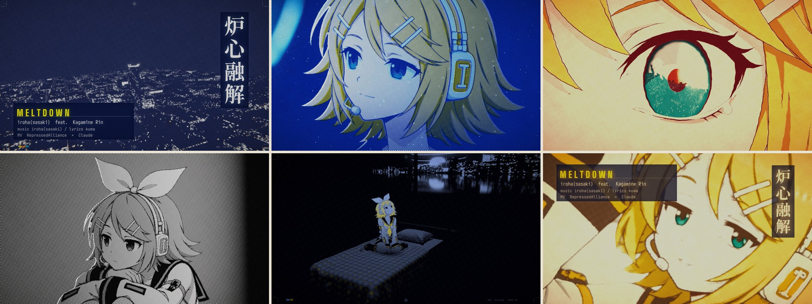
</p>

<h1 align="center">MeltDown</h1>

<p align="center">
  <b>《炉心融解》同人 MV 的完整制作工程</b><br>
  场景、镜头、特效和歌词排版全部由代码生成，生图只用来画镜音铃的分层原画。
</p>

<p align="center">
  中文 · <a href="README.en.md">English</a>
</p>

<p align="center">
  
  
  
  
</p>

<p align="center">
  原曲 iroha(sasaki) · 作词 kuma · 演唱 鏡音リン<br>
  MV <b>压抑同盟 RepressedAlliance</b> × <b>Claude</b>
</p>

---

## 成片

<table>
  <tr>
    <td width="33%">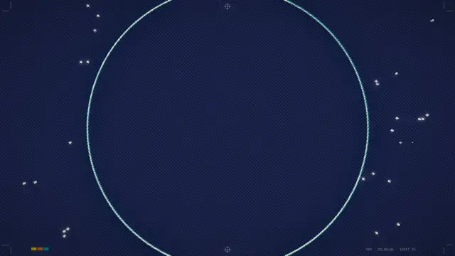</td>
    <td width="33%">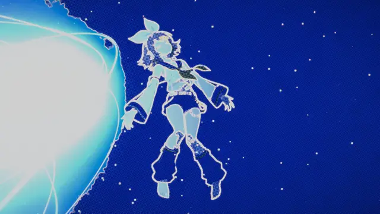</td>
    <td width="33%">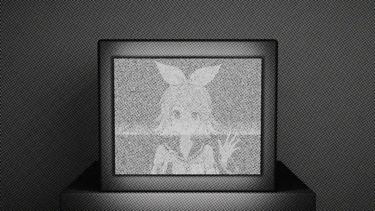</td>
  </tr>
  <tr>
    <td align="center"><sub>开场：从环形灯进入凌晨两点的房间</sub></td>
    <td align="center"><sub>副歌：炉心的光把纸面烧穿</sub></td>
    <td align="center"><sub>桥段：电视里主持节目的也是铃</sub></td>
  </tr>
</table>

<!-- VIDEO -->

## 这是什么

《炉心融解》唱的是凌晨两点睡不着、想跳进核聚变炉里的人。这支 MV 里，镜音铃把胸口越烧越烫的“反应堆”一路带进真正的炉心。画面角落的读数从开头一路升到一亿度，最后溢出；天亮后读数落回 36.5℃，那颗炉心原来是她自己的体温。

全片 5 分 29 秒，82 个镜头：

- **58 个三维镜头**：六叠小屋、夜景城市、托卡马克炉心、黄昏、齿轮。每个场景都是 Python 脚本在 Blender 里程序化搭建的，用 Eevee 渲染。
- **17 个二维镜头**：电视墙、乐谱、标题卡等，直接用 skia 绘制；另有 7 个镜头从已渲染的三维画面里重新剪出，例如桥段里越切越快的蒙太奇。
- **统一的印刷质感**：每一帧都按小批量专色印刷处理，有网点、套色错位和纸纹。副歌里，炉心的光把纸面“烧穿”。
- **逐字歌词**：每个字落在它的音符上，唱到哪个字才出现哪个字。全片用六种排版样式，按段落切换：竖排、副歌大字、回声、电视字幕条、泡泡、乐谱。
- **镜音铃**：42 个姿势和表情的分层原画，每个镜头都有自己的一张。她以卡片的形式放进三维场景，在场景里重新打光，会呼吸、眨眼，发梢也会轻轻摆动。

这不是一键生成 MV 的模板，而是一部片子从头到尾的工程。你可以照着它的方法做自己的 MV，也可以单独拿走其中的工具。

## 可以拿走的东西

| 工具 | 做什么 | 位置 |
|---|---|---|
| 逐字歌词对齐 | 把 V 家歌的每个音拍放到十六分音符网格上。主参照是人工按耳朵打的卡拉 OK 逐字轴，再用声学模型、起音和旋律音高把每个字定到精确的音符 | `src/analysis/` |
| 歌词审计 | 检查全曲：字是否落在长音中间、句子是否比人声先消失、句首是否和 LRC 对得上；再逐帧模拟字幕的出现、消失和排版 | `src/tools/audit_lyrics.py`、`qc_lyrics.py` |
| 二维角色卡片着色器 | 让平面原画在 Blender 里有体积感：伪法线打光、细轮廓光、不在原画上另切明暗交界线的宽幅主光、眨眼换图、按权重的发梢摆动、呼吸 | `src/blender/character.py` |
| 平面角色落座 | 竖直的原画卡片只有脚尖碰得到床。把卡片下部沿相机视线往后推，从镜头看画面不变，臀部却真正坐在被面上，身下压出凹陷和贴着被面的阴影 | `src/blender/bedding.py` 的 `seat_card` |
| 角色素材处理 | 把生成的原图做成分层素材：清理透明边缘、扁平化赛璐璐、生成伪法线、边缘带和头发摆动权重 | `src/char/` |
| 程序化场景 | 实木矮床（立柱、围板、板条床头）、布料模拟的被子和缝合充气的枕头、房间、夜景城市、托卡马克、齿轮组 | `src/blender/` |
| 印刷质感合成 | 调幅网点、专色、套色错位、纸纹，以及副歌的“烧穿” | `src/comp/printlook.py` |
| 字形排版 | 直接取字体轮廓排日文竖排，可以逐字变形、融化 | `src/typo/glyphs.py`、`src/comp/typo_fx.py` |
| 审片工具 | 按秒出带标注的审片拼图（不编码视频，4 分钟看完全片）、切点前后帧对比、原画边缘是否露在画面里、卡片透视压扁检查、推进速度测量、原画复用清点、交给视觉模型逐镜复核的审片图 | `src/tools/` |
| 镜音铃素材 | 42 个姿势的原图、分层素材和生图提示词 | `assets/char/` |

## 画面

<table>
  <tr>
    <td width="33%">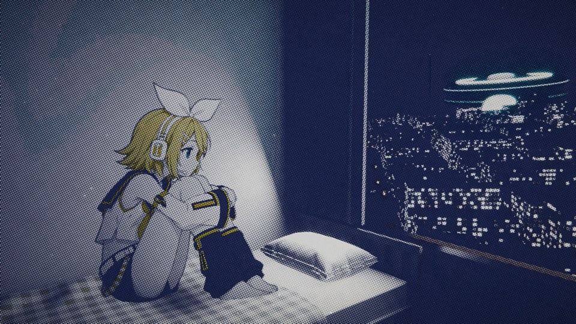</td>
    <td width="33%">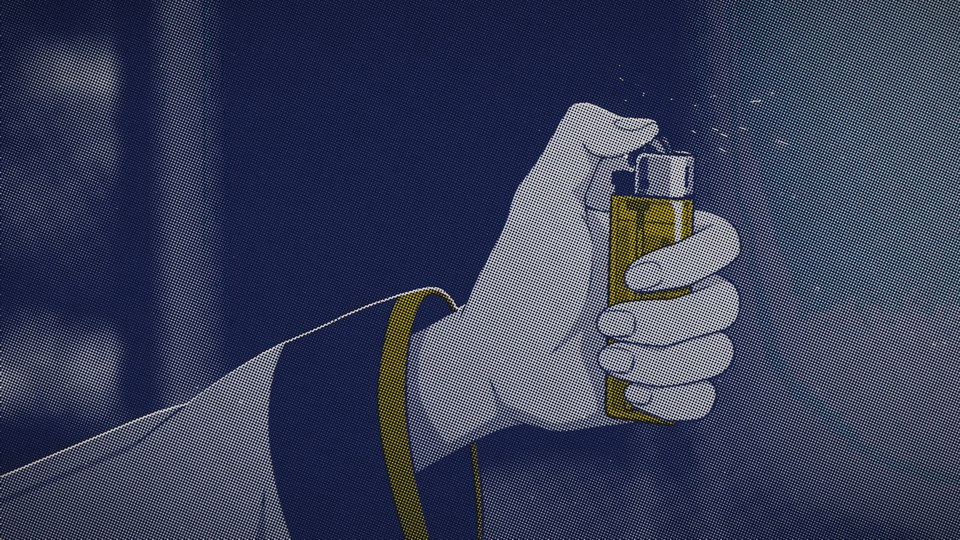</td>
    <td width="33%">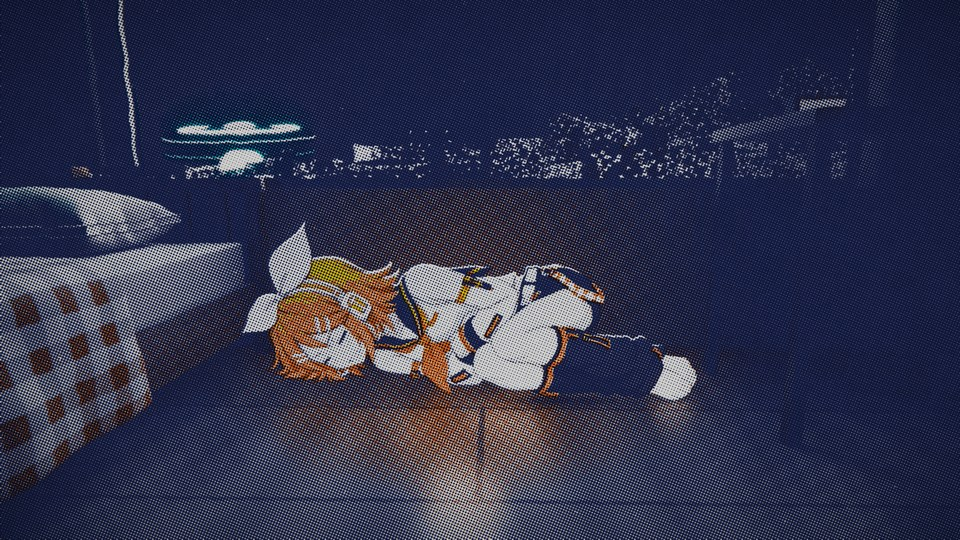</td>
  </tr>
  <tr>
    <td width="33%">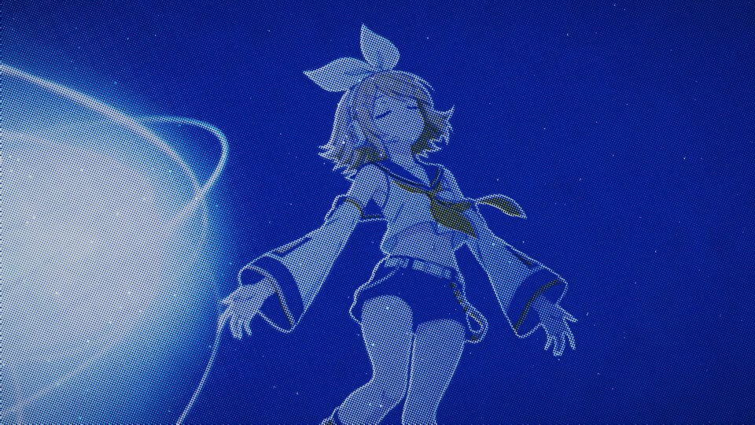</td>
    <td width="33%">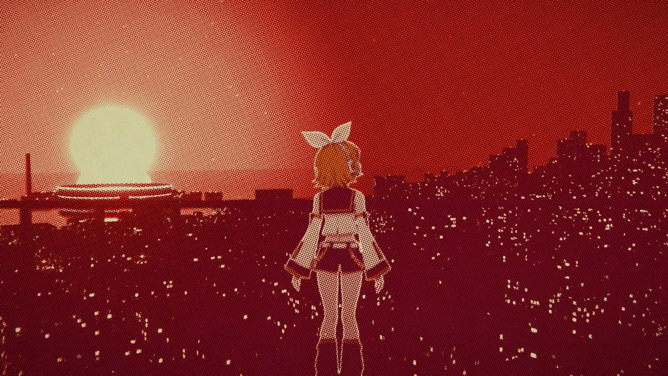</td>
    <td width="33%">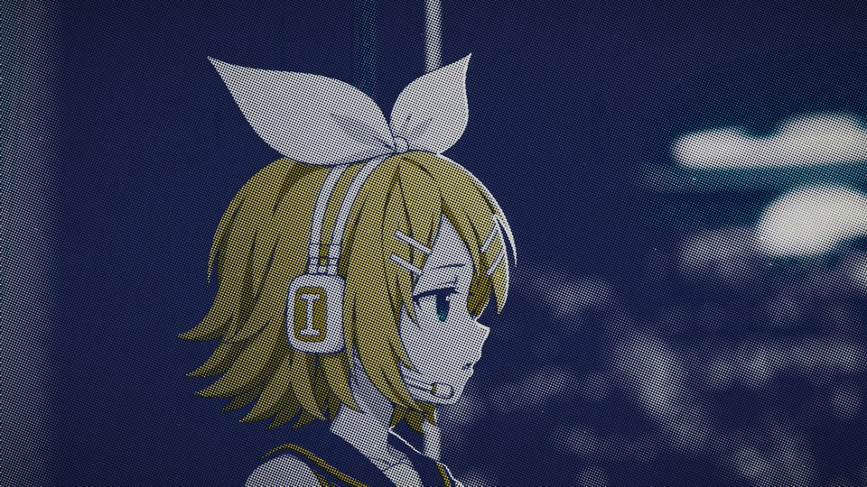</td>
  </tr>
  <tr>
    <td width="33%">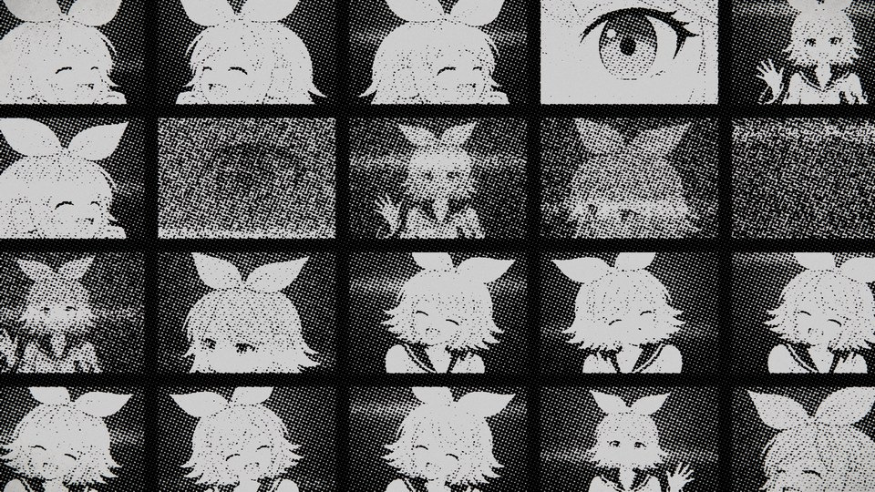</td>
    <td width="33%">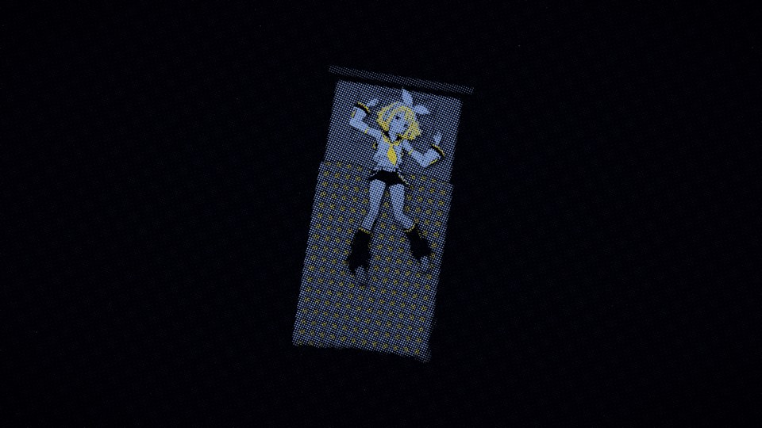</td>
    <td width="33%">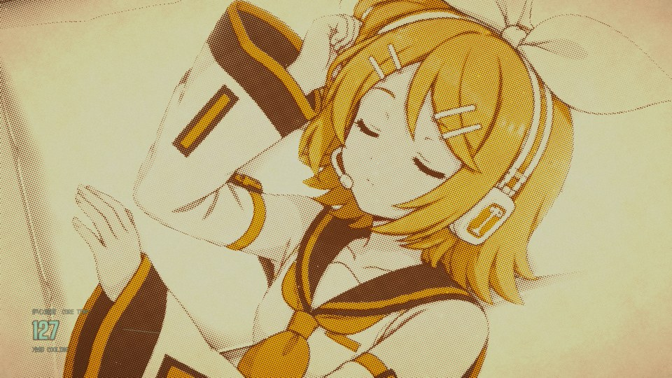</td>
  </tr>
</table>

构想、段落和色彩脚本见 [docs/创作方案.md](docs/创作方案.md)。

## 制作流程

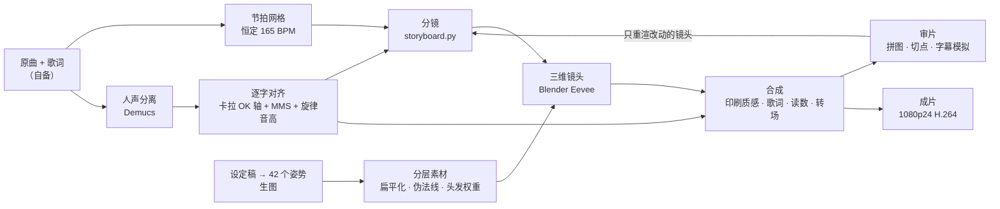

合成器里，一帧按这个顺序处理：

```
Blender 渲染帧 / 二维镜头 ─► 镜头特效 ─► 印刷：网点 · 专色 · 套色错位 · 纸纹 · 烧穿
                                              │
                         歌词（逐字时间 + 本句样式）、控制台读数 ─► 按背后明暗换墨 ─► 转场 ─► 颗粒与调色 ─► 帧
```

每一步的命令和参数见 [docs/制作流程.md](docs/制作流程.md)。

## 快速开始

需要 Windows 10/11、Python 3.12、[Blender 5.2](https://www.blender.org/download/)、[ffmpeg](https://ffmpeg.org/)，以及约 20 GB 磁盘空间。

```powershell
git clone https://github.com/RepressedAlliance/MeltDown.git
cd MeltDown
py -3.12 -m venv .venv
.venv\Scripts\pip install -r requirements.txt --extra-index-url https://download.pytorch.org/whl/cpu
.venv\Scripts\python src\tools\fetch_fonts.py
```

仓库里没有原曲和歌词，请把你自己的文件放进 `input/`：

| 文件 | 内容 |
|---|---|
| `input/song.m4a` | 原曲音频 |
| `input/lyrics.txt` | 歌词，一行一句，段落之间空一行 |
| `input/karaoke.ass`（可选） | 卡拉 OK 逐字轴（`{\k}` 音节），重新对齐歌词时作主参照 |

然后：

```powershell
.venv\Scripts\python src\analysis\analyze_audio.py       # 节拍、段落、响度
.venv\Scripts\python src\analysis\apply_timing.py        # 用仓库附带的逐字时间轴，跳过耗时的对齐
.venv\Scripts\python src\blender\drive_shots.py all      # 渲染 58 个三维镜头（可断点续渲）
.venv\Scripts\python src\comp\render_parallel.py --workers 3   # 合成成片 → out\roshin_yuukai_mv.mp4
```

想从头对齐歌词（换一首歌时必须这样做），按 [docs/制作流程.md](docs/制作流程.md) 里的“歌词逐字对齐”一节运行。人声分离和声学模型都在 CPU 上分段运行，需要几个小时。

参考时间（RTX 4060 Laptop、16 GB 内存）：三维镜头每帧约 1 秒，全部渲染约 2 小时；三个进程并行合成全片约 40 分钟。

## 目录

```
MeltDown/
├── src/
│   ├── analysis/      节拍、人声分离、逐字歌词对齐
│   ├── blender/       场景模块、角色卡片着色器、镜头渲染
│   ├── char/          角色素材处理
│   ├── comp/          合成：印刷质感、歌词动效、读数、二维镜头、转场、输出
│   ├── typo/          字形排版
│   ├── tools/         审片、质检、封面、生图脚本
│   ├── storyboard.py  全片分镜：每个镜头的时间、场景、相机、角色、特效、歌词样式
│   └── timeline.py    节拍网格与歌词时间
├── assets/
│   ├── char/          镜音铃：prompts/ 提示词、raw/ 原图、<姿势>/ 分层素材
│   ├── plates/        窗外城市贴片、时钟数码管贴图
│   ├── tv/            电视里播出的画面
│   └── fonts/         字体（fetch_fonts.py 下载）
├── data/              逐字时间轴（不含歌词文本）
├── docs/              创作方案、制作流程、制作手记、图片
└── input/             你自己的原曲和歌词（不进仓库）
```

## 制作手记

这支片子前后改了八版。[docs/制作手记.md](docs/制作手记.md) 记录了每一版改了什么、哪些方法试过但失败了，以及怎样避开这些坑。最重要的几条：

- **AI 感来自头发、衣褶和柔光。** 先出一张 TV 动画设定稿风格的三视图，其余姿势都以它为参考图；提示词把头发限制在 6–9 束大发块，衣服只留必要的褶皱，阴影只用两色硬边。
- **别相信节拍检测给的 BPM。** 节拍检测报的是 110 BPM，实际是恒定的 165 BPM。用鼓轨拟合出十六分音符网格，误差 ±6 ms，切点和特效都踩在这个网格上。
- **歌词要跟着歌手实际怎么唱。** 整体对齐对了，并不代表观众觉得对。单独起唱的字、被长音断开的句子、段尾的效果人声，才是听的人最在意的地方。人工按耳朵打的卡拉 OK 轴比任何自动对齐都可靠，我们凭频谱手工修的地方错了一半。
- **平面角色放进三维要一个镜头一个镜头地摆。** 卡片斜着看会被压扁；躺着和坐着的镜头，卡片的朝向、相机的方向和床的位置都不一样。原画是从斜上方画的，竖着放的坐姿卡片会悬空：沿视线把它的下部推回去，她才坐得住。
- **审片比渲染重要。** 每秒一帧的标注拼图几分钟就能看完全片。每发现一个问题，都在全片里查一遍同类问题，不只修被指出的那一处。

## 署名与致谢

- **MV**：压抑同盟 RepressedAlliance（方向、审片、逐字听校歌词）× Claude（构想、代码、渲染、自审）
- **原曲**：《炉心融解》 作曲 iroha(sasaki)，作词 kuma，演唱 鏡音リン
- **镜音铃**：© Crypton Future Media, INC. 2007。本片使用的是镜音铃角色的改编插画，依照 [CC BY-NC 3.0](https://creativecommons.org/licenses/by-nc/3.0/) 与 [Piapro Character License](https://piapro.net/license) 进行非商业创作
- **角色原画**：用 OpenAI 的图像模型（经 Codex CLI 内置的生图工具）按 `assets/char/prompts/` 中的提示词生成，再由本工程的脚本处理
- **卡拉 OK 逐字轴**：ENSSAT-Japanim 制作的 .ass 时间轴，只在本地作为对齐参照，不随仓库分发
- **字体**：Shippori Mincho B1、Zen Old Mincho、Zen Kaku Gothic New、Dela Gothic One、M PLUS 1 Code、JetBrains Mono、Big Shoulders、Instrument Serif，均为 SIL Open Font License（由 `fetch_fonts.py` 从 google/fonts 下载，不随仓库分发）
- **工具**：[Blender](https://www.blender.org/)、[FFmpeg](https://ffmpeg.org/)、[Demucs](https://github.com/facebookresearch/demucs)、[torchaudio MMS_FA](https://pytorch.org/audio/stable/tutorials/forced_alignment_for_multilingual_data_tutorial.html)、[librosa](https://librosa.org/)、[skia-python](https://github.com/kyamagu/skia-python)、[fontTools](https://github.com/fonttools/fonttools)、[OpenCV](https://opencv.org/)、[pykakasi](https://codeberg.org/miurahr/pykakasi)
- 用 [Claude Code](https://claude.com/claude-code) 制作

## 许可

- 代码和文档：[MIT](LICENSE)，© 2026 RepressedAlliance（压抑同盟）
- 镜音铃的原画、分层素材和 MV 画面：[CC BY-NC 4.0](https://creativecommons.org/licenses/by-nc/4.0/)，仅限非商业使用，并须同时遵守 Crypton 的角色使用条款
- 程序生成的贴图（`assets/plates/`）：MIT
- 字体：各自的 SIL Open Font License

**仓库里没有歌曲音频、歌词文本和成片视频。** 《炉心融解》的词曲版权属于原作者。完整的素材与许可说明见 [NOTICE.md](NOTICE.md)。

VOCALOID 是雅马哈株式会社的注册商标，鏡音リン是 Crypton Future Media, INC. 的商标。本项目是独立的同人创作，与雅马哈和 Crypton 没有关联。
