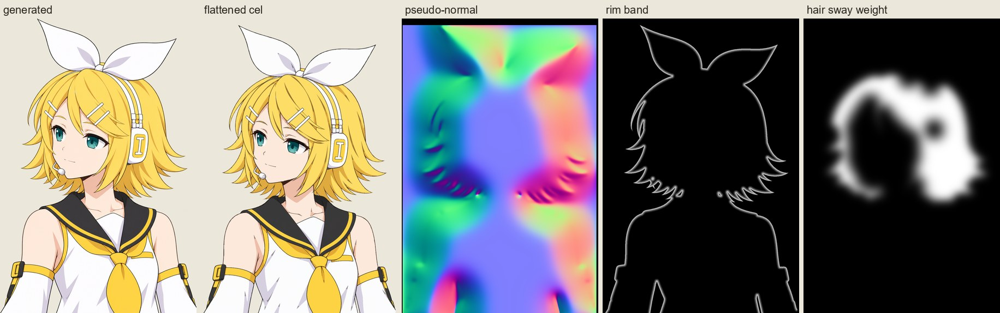
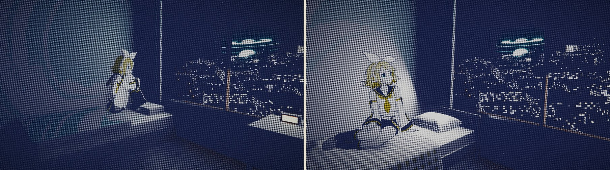
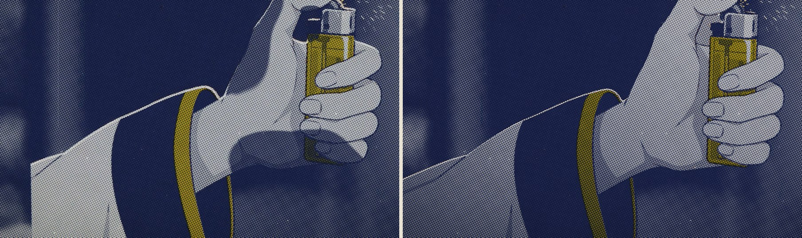
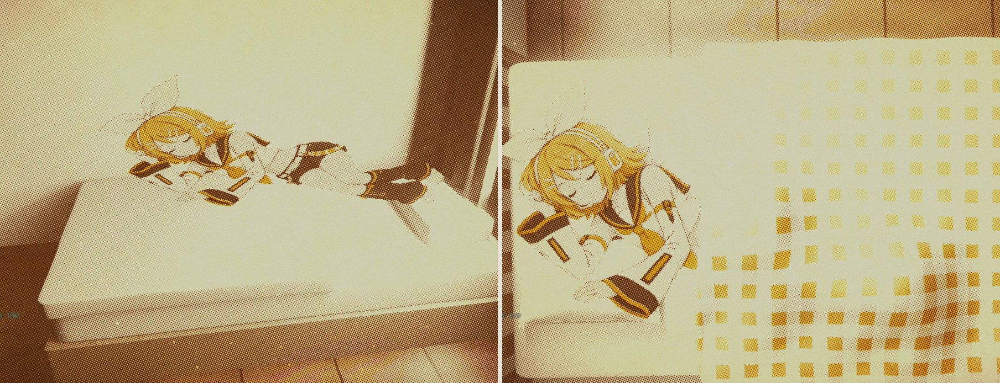

# 制作手记

《炉心融解》这支 MV 前后改了八版。分工很简单：压抑同盟定方向、审片，并逐字听校歌词；Claude 负责构想、写代码、渲染和自审；镜音铃的原画由图像模型按提示词生成。这份手记记录每一版改了什么、哪些路走不通，以及我们从中学到的东西。最后一节是给想做类似作品的人的一份检查清单。

## 一版一版地改

**起点。** 目标是 BlackDawn 用 Claude 做的《千本桜》MV 那样的完成度：一套为这首歌定制的图形语言贯穿每一帧。我们给自己定了一条规矩：生图只用来画镜音铃的分层原画，场景、镜头、特效和歌词全部用代码做。

**第一到第四版：把管线搭起来。** 这几版做了 Blender 程序化场景、Python 合成器和印刷质感，也给铃去掉了“AI 味”（见下文“角色”）。

**第五版：第一次正式审片。** 压抑同盟提了六条意见：

- 打火机的火花没从火石轮上冒出来；
- 桥段歌词和演唱对不上；
- 齿轮互相穿模；
- 电视里的人应该是铃；
- 铃的戏份要多；
- 结尾太素。

六条全部改完。这一轮的体会是：只要拿不准，就给这个镜头专门画一张铃，而不是借用旧姿势或者留一个空镜。

**第六版：歌词逐字对到音符。** 这一版发现全曲其实是恒定的 165 BPM，节拍检测报的是 110。结尾特写里的头发像叠了两层，原因是卡片的打光叠在原画已画好的阴影上，改成平光解决。

**第七版：按耳朵校准歌词。** 压抑同盟指出 0:31、3:06–3:18、5:01–5:04 几处没跟上实际演唱。这三处都是自动对齐“整体正确”、听众却一下就能听出来的地方：

- 0:31 有一个字在乐队进来之前单独唱出；
- 3:06–3:18 一句歌词被长音断开；
- 5:01–5:04 段尾的效果人声被分离到了伴奏轨里。

最后的解决办法是找一份人工按耳朵打的卡拉 OK 逐字轴，作为主参照。

**第八版：床、截断和光。** 压抑同盟的意见：

- 床戏里铃头脚颠倒，床像几块立方体；
- 结尾人物有点扁；
- 0:43 的手臂在画面里被截断；
- 头发飘动像两层、速度太快；
- 电视里的铃应该露出麦克风；
- 开场转场不够顺。

这一版把床做成了真正的家具（实木床架、布料模拟的被子、缝合充气的枕头），按姿势重新安排每个床戏镜头，写了检查工具找出全片所有“铃不完整”的地方，把卡片的主光改成渐变光，并请视觉更强的模型把全片逐镜复核了三轮，每轮的意见都按类别在全片修改：取景（蝴蝶结、手、脚不被画框切掉）、歌词的可读性、印刷对细节的吞噬。

**第九、十版：匀速、完整、不复用。** 意见集中在“生硬”和“不完整”上：开场有推有停、2:17 转场生硬、床上的脚像被截断、0:45–0:56 三个相似的半身、2:46 只有齿轮太空、结尾 5:09 晃动和 5:16 换图生硬、老是复用几张图。这两版把开场改成匀速推进，在换场的切点上加了叠化和推进穿越，床戏加了轮廓和贴床阴影，新画了十二张姿势，结尾改成同一张画里醒来。

**第十一版：转场不是越多越顺。** 压抑同盟看了第十版说：开场太慢，又全是转场，一点也不丝滑，“是不是因为我说生硬就胡乱加了转场”；0:49 的倒影身体不全、半透明、和前后接不上；3:11 和 3:24 突然局部放大，电视、话筒和铃都看不全；楼梯那段动态演出很好，但全片只有这一处，怕不协调。说得都对：第九版把“生硬”理解成“缺转场”，分镜里定了“换地方就叠化”，全片四十多处带转场，开场一处硬切都没有；速度做“匀”了，却没有和满能量的前奏相称。这一版把转场重新判断了一遍，开场按小节重排、推进提到每秒约 22%，0:49 重做成全身的倒地戏，桥段去掉所有局部放大并按歌词重排，又在全片加了七处踩着拍子的动作。

## 我们学到的

### 角色：AI 感从哪里来

生成的动漫角色一眼看上去像 AI，原因集中在三处：头发碎成很多细丝、衣服褶皱太多、柔和的渐变光。提示词里写明 TV 动画设定稿的画法，问题就基本消失：

- 头发 6–9 束大发块；
- 只留两三条必要的褶皱；
- 每种材质一个底色加一个硬边阴影色；
- 线宽统一，光照中性，背景透明。

先生成一张三视图设定稿，之后每个姿势都以它为参考图，角色就不会走样。

### 平面角色放进三维场景

铃是一张张贴图卡片，这种做法的问题都出在“卡片”二字上：

- **原画的边露在画面里。** 手臂碰到画布边缘，原画就在那里截断。在镜头里，这就是“突然冒出来的一截手”。这类问题肉眼很容易看漏，我们第一次就看错了地方，以为是手心有个洞。现在用 `card_audit.py` 把每个不透明像素投到画面上逐一检查；生成新姿势时，提示词要求人物不碰画布的左右和上边。
- **陷进家具，或者浮在上面。** 坐在床上的铃，下沿比被面低了 5 cm，脚和臀部就被被子吃掉了。把原画的最低点落到被面上之后，又发现她其实是悬空的：原画是从斜上方画的，臀部在画面里比脚尖高 5–8 cm，一张竖直的卡片只有脚尖碰得到被子。解决办法是把卡片的下部沿着相机的视线往后推，直到每一处承重的边（臀部、脚掌）都落在被面上：从镜头看，画面一个像素都没变；在场景里，臀部到了脚的后面，正好坐在床垫压出的凹陷里，身下的阴影也贴着被面。
- **斜着看会被压扁。** 卡片朝向相机，或者把相机控制在卡片法线附近 30° 以内。
- **代码打的光会和原画的光打架。** 按伪法线算出的明暗交界线，会在脸上切出一条和五官无关的灰带，在头发上叠出“第二层”。原画上的赛璐璐阴影才是唯一的阴影来源，代码只负责色温、宽幅渐变和细细的轮廓光。

- **躺着的姿势只能从上面拍。** 卡片沿床身倾斜几度，头的一端高过枕头；被子按她原画的轮廓隆起盖住身体，再加一层柔和的轮廓阴影，她就“躺在床上”了，而不是“贴在床上”。

### 被子

几何体拼的床一眼就假。床架照真实的实木矮床来搭：床垫角外的四根立柱、床垫嵌进去的围板、床头七根板条加一根顶档，每块木料的纹理顺着它自己的长边。被子改用 Blender 的布料模拟，在床角垂成锥形褶，盖着身体时自然起伏。踩过的坑（细节见 `bedding.py`）：

- 初始网格里有重合的顶点，模拟会静默地什么都不做；
- 碰撞体的一部分从布料里穿出来，模拟会炸开；
- 被子下的“身体”要先做形态学闭运算，被子才会跨过四肢之间的空隙，形成一整块宽而圆润的形体，而不是每个膝盖、手肘各顶起一个包；
- 低角度的太阳会在被子的每处起伏后面拖出长长的暗影，看起来像污渍。白墙房间里本来有大量的反射光，补上一层环境光，问题就消失了；
- 往床上投射线找表面时，要先把铃的卡片从场景里拿掉，只“跳过”它不够：卡片插进被子一点，射线从卡片那里接着往下走，就已经在被面以下，会打到被子的底面。身下的阴影因此沉下去一圈，画面上出现一道浅色的环；
- 缓存的键要从网格数据算，不要用物体的 `dimensions`：顶点刚改过、还没求值时它是旧的，同一张床会被当成两张，各自模拟出略有不同的被子。

### 印刷质感会吃掉细节

全片每一帧都按网点印刷处理，渲染里看着不错的东西，印出来可能什么都不剩。床就是这样：原始渲染里有淡黄格纹、褶皱和身下的阴影，印出来却是一块均匀的灰色网点，审片模型一眼就说“像硬板”。原因有两个：淡黄色在蓝色夜光下饱和度只剩 0.18，低于黄色专色的阈值，格纹整个没印出来；褶皱的明暗差又太小，被网点量化掉了。改成 4 cm 的深赭黄格纹（即使颜色被夜光洗掉，也能靠网点疏密印出格子），垂下床沿的被边带上初始波纹落成竖褶，夜景再加一盏不投影的弱月光沿床扫过，床才在成片里立起来。

教训：判断画面要看合成后的成片，不能只看渲染。我们写了一个小脚本，直接用合成器的印刷函数处理渲染帧，几秒钟就能比较改动前后的效果。

头发的“两层”也是印刷造成的。原画里头发暗部的色相（30–40）比黄色专色的范围（40–66）偏暖，暗部于是只用主色墨印出来，成了垫在黄色头发下面的一层灰色头发；在蓝色炉心光里亮部又偏到 66 以外。把铃的黄色专色范围扩到 28–72（偏暖的那一段只收高饱和度的颜色，皮肤不会被卷进来），暗部就印成深一级的黄色，头发回到一层。我们先在原画和渲染里找了很久，答案却在合成的最后一步：查问题要逐层对比，渲染、印刷、成片各看一遍。

桥段的齿轮是黑白网点印的。铃按平常的曝光渲出来，饱和度一去掉，就和钢铁印成同一种中灰，推近到她身上也认不出来；把她的曝光提到 1.35，印出来接近纸白，才从深色的齿轮里跳出来。推进原来停在离她 3.5 米处，她只占画面四分之一高，印出来仍是轮毂上的一团灰，现在推到 2.5 米，占五分之二。相机从高处往下看她，纸片人会被压扁一成多：卡片沿高度拉长 1.117 倍（俯角余弦的倒数，`stretch`），再整体下移 1 厘米，让坐点仍落在销钉帽上；`card_angles.py` 现在按 5% 的标准检查全片卡片，并且在视线落在卡片上的那一点测量，特写里不会被画外的部分误报。之后那间暗房（2:59）也一样：她的浅色头发去色后和身后被照亮的墙是同一种浅灰，把这一镜的窗光降到 0.45，墙暗下去，她的头发和衣服就比墙亮了一截。

同样的问题还有两处：白色副歌里，“光烧穿纸面”的阈值是按亮度定的，她的白衬衫和皮肤加上泛光后比任何阈值都亮，整个人被烧成一个空白剪影，这两个镜头只好关掉烧穿；歌词按背景明暗换墨时，一行字跨过亮暗交界会被拆成黑白两半，改成每一句只决定一次用哪种墨（按整句字形下面的平均亮度），亮处另垫一层柔和暗影。

### 转场：先问画面有没有理由

第十一版最大的一课。“生硬”不等于“缺转场”。一个硬切显得生硬，是因为运动接不上（这边推、那边停）、视线接不上（眼睛看着的东西跳到了别处）或者切点不在音乐的拍上；加一个叠化只是把两张不相干的画面叠在一起半秒，开场十一个切点全是叠化，看起来就是一张张幻灯片在慢慢溶。现在的规则写在 `storyboard.FLOW` 的注释里：默认在拍点上硬切，靠运动方向和速度、靠同一个形状在同一个位置（片名的光环正好是床头灯环的大小，灯环在鼓点进来时撑满画面、换成她的眼睛）把两个镜头接起来；只有画面本身给了理由才用别的：光（乐队停下变暗、静默的黑、白色副歌褪成的白、过热的白、日出的白）、同一张画变成另一张画（她和她的图解、结尾同一张画的叠化）、开场那个光环在静默里重画再张开。静默后音乐炸开的三个重拍保留闪光。全片带转场的切点从四十多处减到十二处，每一处都写着理由。

4:10 是个小例子：灯一盏盏灭掉后，原来把远处那个小小的人数码放大、叠化成她的特写，像镜头硬拽过去。现在灯灭完她自己也暗下去，在静默里黑一会儿，她的脸再从黑暗里慢慢浮出来：黑暗本身就是转场的理由。

### 转场：画面要跟着音乐走，镜头要一直往前（第九、十版）

- **开场一路向前推。** 第八版的开场有推有停：几个机位用缓入缓出，到切点时速度降到零；二维的放大前八成时间不动、最后一下猛推；有两个镜头其实在往后拉；推进穿越的转场还把新镜头从 1.18 倍缩回 1 倍，看起来像倒退了一下。导演说的“又有推进又有停顿”就是这些。现在开场每个机位都匀速向前，二维画面按指数匀速放大，转场只把前一个镜头的推进交给下一个；窗外的炉心在下一个镜头里从同一个位置、同样大小开始，房间溶掉，镜头接着飞过去。
- **切点要落在音乐真正的停顿上。** 2:17 那个切点在节拍网格上，却比乐队停下早了将近一秒：人声和伴奏还在继续，画面已经切进黑场。现在房间随着乐队停下而暗下去，光环在静默里画出来。
- **按数据找生硬的转场。** `cut_report.py` 把每个切点前后的亮度、颜色跳变和“是否切在一句歌中间”列出来，再配合切点对比图逐个判断：副歌和桥段的蒙太奇保留踩拍的硬切；换地点、换段落、亮暗反差大的地方，或者在安静段落里切断一句歌的地方，改成叠化、推进穿越（推进她的胸口、她的眼睛、她眼中的落日）、闪白或经白场淡入。叠化底下的上一个镜头要多渲染一段“尾巴”，否则它会定格。
- **叠化要有落点。** 外部审阅指出，整幅叠化常常只是“两张不相干的画面叠在一起”：炉口的亮环横穿房间，楼面压在室内，床上的身体和窗前的背影叠成两个方向。改法是找到两个画面共有的那一点：上一个镜头正飞向的光（窗外的炉心、炉口、街谷尽头、打火机的火口、夕阳），或者人物身上的同一处（眼睛、按着胸口的手、睡着的脸）。推进穿越朝这一点推，下一个镜头从这一点向外展开，旧画面从中心开始被替换，不会出现两个完整的画面重叠。监测图的圆圈展开成黄昏里反应堆的光环；静默里画出的光环直接从自己的半径张开，进入第二段副歌。
- **切点那一帧要属于新镜头。** 很多切点按节拍算出的时间比整帧多出千分之一帧，合成程序按时间判断，就把切点那一帧算给了上一个镜头，而那一帧在上一个镜头的渲染范围之外：要么重复它的最后一帧，要么用上旧版本留在目录里的另一个机位，看起来像切点前突然放大了一下。现在按帧号判断镜头归属，和分段、Blender 渲染范围用同一个规则。

### 推进的速度要和音乐相称

第十版把开场的推进统一成每秒 12–14%，测出来很匀，看起来却慢：0:07.62 鼓点进来以后，前奏是满能量的 165 BPM，画面还在慢慢挪。数字过关不等于看着对。第十一版保留“一个速度”的要求，把这个速度提到每秒约 22%（`storyboard.PUSH`），切点挪到小节线上（鼓点进来、镲片落下），删掉了海面上那一镜空景。速度按画面实测：城市俯冲里近处的高楼比注视点近得多，按地面设的机位在画面上快到每秒三成；俯视城市要按楼顶设注视点，否则越往下越快；房间里的镜头，窗外的远景不随推进放大，要只量人物所在的区域。

### 匀速推进要靠测量，不靠感觉

导演要的是开场“所有往前都是一个速度”。把成片开场逐帧测出来，速度从每秒放大 10% 一路涨到 150% 以上（城市俯冲），又跌回个位数，转场处还各有一个尖峰。原因有三个：各镜头的机位各走各的；线性移动越靠近目标在画面上越快；推进穿越的转场在切点后额外加了一次冲刺。现在定一个统一速度（每秒 14%），每个镜头的机位按实测速度缩放行程，并改成恒速缓动；二维画面按同一速率放大；转场不再加推，只做柔和展开。结尾也照此处理：从整张床到她的睡脸是一条恒速的机位，切点落在这条机位上看不出来，最后在特写里慢慢停住。第二轮测速又找出两处：城市俯冲（0:11）还快两成，行程再缩短五分之一；海湾上空那一镜（0:16）是从岸边起飞的，岸上一排塔楼从画面左边掠过，前一秒局部放大达到每秒四成到一倍以上，改成从离岸 110 米的海面上起飞：把每一栋楼投影到每一帧，再按叠化的展开顺序加权，确认观众看得到的画面里没有近处的楼。测速时要分清真快和假快：叠化中两幅画面交叠、画面里只有远景时的读数都不可信，三维镜头在原始渲染帧上测，再对照画面判断。

### 同一个景别不要连着出现

0:45–0:56 连着三个居中、朝右的半身铃（捂胃、窗前、晨光），即使姿势不同也像跳切。中间那个本来就是“窗玻璃上的倒影”，只是太实了：现在换成一张正面看着玻璃的脸，半透明、缩小，城市灯光从她身上透过去，一看就是倒影，方向、质感和景别都和前后两镜分开。

第十一版又改了一次：半透明的倒影是叠在画面上的特效，不是场景里的人，身体不全、质感和前后都不一样，动作上也接不上前一镜捂着胃的她。现在中间这一镜是暗房里的全身戏：她捂着胃，一小节一个姿势地弯下腰、跪下、蜷倒在地上（三张新画逐格切换），前一镜图解里画在她胃里的那个圆环，在这里是一团按拍子明暗的暖光，照亮她身下的地板，镜头随她往下沉；然后切进白色的梦。景别（全身）、方向（朝左）和前后两镜都不同，动作却是接着的。取景时把她站着时的蝴蝶结、跪着时的手、躺下时的头脚在整条推进里的位置都算了一遍，三个姿势都完整在画内。

### 踩着拍子的演出要成为一种语言

楼梯那段（每拍上一级、踩到的台阶亮起来、影子顺着墙往上走）是全片最受喜欢的地方，但只有一处的话就显得突兀。第十一版把“铃跟着拍子做动作”做成贯穿全片的演出语言：0:27 在小节重拍上睁开眼睛（睡不着），0:31 唱出第一个字时手贴上窗玻璃，0:42 拇指在一、三拍上擦打火机、每下都迸火花却点不着（歌词说的是没油的打火机），0:49 一小节一个姿势地倒下，2:46 坐在时间机器的销钉上每两拍换一只脚晃，3:12 电视里的她每拍挥一下手，3:35 耳鸣里每逢一、三拍捂紧耳朵一缩，5:18 在最后一小节的重拍上醒来。手法都是逐格换图：成组的新画，或者同一张画只动一个部位的变体（`src/char/variant.py`：模型的编辑只取那个部位，其余像素和原画相同，换图时只有那个部位在动）。换图落在两帧之间，任何一帧都不会出现两张画。

### 不做局部放大

桥段原来用“加速剪辑”收紧节奏，素材是已经渲染好的画面裁一块放大：3:11 放大到电视只剩半个，话筒和她的手都出了画；3:15 是巨大的“02:00”；3:24 又放大一次。这是用剪辑软件的办法省掉重新拍，代价是主体被切掉，画质也虚。现在不做任何数码局部放大：桥段的每个画面都是完整的，节奏靠镜头本身的内容（时钟按拍走、电视里的她按拍挥手）和越来越快的硬切；顺序也按歌词排：唱到时钟时是时钟，唱到电视主持人时是电视里的她。

改完以后自查又发现一处变相的放大：从整台电视直接切到电视画面铺满全屏（3:16），是同一张画面突然变大一倍半，和裁切放大没有区别。现在两者之间插一个她看电视的近景，后面的全屏画面就成了她看到的东西（正反打），电视那一镜也收住推进，整台电视始终在画内。

### 每个镜头都要有自己的画

导演看片时觉得“老是复用几张图片”，确实如此：抱膝坐在床上的同一张画出现在四个镜头里，0:13 和 2:06 连机位都差不多；漂浮的同一张画用了四次，其中两次是同一个机位。原因不在生图的成本，而在于旧画已经调好了卡片高度、床面接触和光照，换新图要重新对位，于是每次加镜头都先拿现成的。现在逐镜清点（`pose_audit.py`），重复的地方各自生成新姿势：侧坐望窗、盘腿呆坐对着电视雪花、跪坐仰望虚空、坐在齿轮销钉顶上悬着脚、睡着漂浮、俯冲进炉心的光、摊开手脚躺在被子上、上楼梯的两帧、正面的倒影、更近的捂耳、瞳孔收缩的眼睛。留下的重复都是有意的：结尾同一场连续的睡姿，以及两处“实拍变线稿、线稿变实拍”的对接。

### 圆形接圆形，要落在同一个地方

转场去掉以后，硬切要靠两个镜头共有的形状接起来。片子里这样的形状很多：片名光环、床头灯环、瞳孔、反应堆的光环、夕阳。第十版用推进穿越把它们“推”到一起，硬切时就得在画面里真的对上：1:37 监测图上的反应堆光环在镜头里匀速放大 1.8 倍，切点那一帧正好落在下一镜夕阳的位置、同样大小；1:57 的夕阳把机位抬高 0.54°，最后一帧的圆心落在下一镜她瞳孔的中心。位置和大小都在成片的帧上量：光环用颜色挑出像素拟合圆，夕阳先模糊掉网点再拟合左右边缘。

### 床上的脚印出来不见了

导演说坐在床上的几处“脚被截断了”。原画和渲染里脚都是完整的，问题在印刷：浅色的光脚和白床单亮度一样，网点把两者都印成纸色，脚的形状只剩几颗稍大的网点，2–3 像素的轮廓线也扛不住 5–6 像素的网点。改法是给床上的镜头加两样东西：外轮廓压一道深色（`ink`），原画最下面贴着床的那一段略暗（`floor_shade`，脚缩在膝盖下面，本来就在阴影里），脚就印成一片网点，从白床单上分出来。躺着的 S32 也是同一个问题：白衬衫和露出的腰印出来和白床单连成一片，身体像在被沿之前就断了，加上外轮廓后一直接到被子底下。判断要放大看合成后的成片，渲染图里永远看不出这个问题。

### 醒来要接在睡着的同一个姿势上

结尾从睡着（全身躺在床上的那张画）叠化到醒来（脸部特写的另一张画），两张脸在画面里差了将近 90 度，叠化时看到的是两张脸。原因是睡姿卡片在床上转了 −90 度，醒来的卡片没有转。先按五官（双眼、嘴、话筒、发夹、耳机）拟合一个相似变换，把醒来的卡片转到同样的方向、缩放并平移到同一处，眼睛误差 3–4 毫米。脸对上了，审片表上身体却对不上：睡姿里举在头边的手臂和袖子在叠化中淡掉，留下一片空枕头，看起来还是一张图换成了另一张，正是导演说的“切换图片”。

最后的做法是结尾根本不换图。让图像模型把睡姿的表情改成刚睡醒、看向镜头、淡淡微笑的样子（只改眼睛、眉毛和嘴）。模型改表情时会把全身线条都轻微重描一遍，所以只把两只眼睛和嘴所在的三个椭圆区域对齐后补进睡姿原画（`src/char/expression.py`），其余部分和原画逐像素相同，闭眼状态就是睡姿原画本身。S65c 开头显示的和 S65b 完全是同一张画、同一个位置，最后一小节的重拍上才换成睁眼微笑：叠化前后没有任何变化，她在原来的姿势里睁开眼睛。换成全身那张画以后，脸落在画面下半部分，片尾的署名底板放在左下会挡住笑容、放在右下会挡住右眼，于是加了一个左上角的位置（`panel="top"`），压在袖子和头发上。放字幕前要在整段显示时间里逐帧看它盖住了什么，只看一帧不够。

对齐了还不够，两个画面在叠化的 1.2 秒里还得一起动。为了让最后的特写把脸停在左边，S65c 的机位要横移 13 厘米，一开始就以最快速度移；S65b 结束时几乎不横移，两张对齐的脸会以每秒约 290 像素的速度错开。现在注视点的移动单独处理：S65b 以 S65 结束时的速度出发、在切点停住，S65c 从静止出发再漂到最后的构图；推进本身两边都是每秒约 11.5%。切点两侧的速度在渲染前就用机位函数算过一遍。复核时又发现，推近途中瞄准点一直停在她胸口，到一半蝴蝶结和举过头顶的手臂就被画面上边切掉了，身体却还在画面中间；现在白场一过，瞄准点就先快后慢地移向她的头，在切点停住，头顶一直留在画面里，直到最后的面部特写。

### 叠化里，同一样东西要停在同一个地方

S05 窗外的反应堆光环要叠化进 S06 飞向反应堆的镜头。S06 为了避开岸边的楼改了起点，首帧的光环就比窗里的那个偏左 140 像素、偏下 70 像素，而且两个环往相反方向漂（窗里的慢慢向右，S06 的每秒向左两百多像素），0.6 秒的叠化里最多错开 300 像素，看到的是两个环。用相机投影算出 S06 开头该朝哪里看，让光环在叠化中点和窗里的重合；注视点改走一条三次曲线（`aim_v0`），出发时让光环像窗里那个一样几乎不动，再加速转回原来的路线，最后半秒和原路线完全一致，接 S07 的位置不变。现在叠化的前七成时间里两个环相差不到 30 像素，后面窗里的画面已经淡出。

### 背景里的线不能从她身上长出来

复审挑出了几处相切：S11、S15 她身后窗帘的亮边正好落在蝴蝶结的结心上，像头饰上插了一根杆；S10 远处反应堆的亮环一直贴着蝴蝶结的右翼；S42 一整行大字的最后几个字压到了她的脚。改法各不相同，原则是一个：只改背景和她的相对位置，不改她在画面里的构图。S11、S15 把相机和卡片一起沿画面横向平移 25 和 37 厘米，她在画面里纹丝不动，窗帘边移到她头发外侧一百多像素（S15b 的透视对位因此不用重测）；S10 的城市背景板在窗外 45 米，相当于无穷远，只平移相机、注视点不动，她几乎不动，光环先停在蝴蝶结和窗棂之间（两边各空出约 35 像素），随后退到她头后面；S42 的歌词和同类大字保持一致，把镜头焦距缩一成、卡片沿画面向上移约 10 厘米，脚底离字顶留出 80 像素。

### 线稿要按透视对齐

S55 的线稿要在叠化中和 S56 的她重合。先试了缩放加旋转的最佳拟合，上半身对上了，腿始终偏：相机近、从下往上拍，卡片在画面里是透视变形的，离相机近的腿更大。改成从 Blender 里读出卡片四个角在那一帧的位置，用透视变换铺线稿，整个人都对上了。顺带发现，线稿的推进原来是放大成品画面，放大中心在画面外，画面底部只能镜像补出来，圆环变成了上下两个；现在每帧按放大后的尺寸重新画线稿，不会再缺边。

### 头发摆动的幅度要按屏幕像素算

头发“两层”是印刷造成的，修好之后，摆动幅度却一直按原画的比例在调，算到屏幕上只有 2–6 像素，比网点还小，等于没有。现在按每个镜头的焦距和距离反算：发梢摆 7–13 像素，风里的镜头约 3.5 秒摆一次，失重漂浮的镜头约 4.3 秒一次。

### 节拍

别相信节拍检测报的 BPM。这首歌被检测成 110 BPM，实际是恒定的 165。我们用鼓轨拟合出十六分音符网格，误差在 ±6 ms 以内，所有踩拍的效果都用这个网格；切点吸附到八分音符，迎接人声的切点放在起唱前一个八分音符。

### 歌词：观众在意的是歌手实际怎么唱

自动对齐的结果“整体正确”，不等于听的人觉得对。听众最在意的是：单独起唱的字、被长音断开的句子、段尾的效果人声。

| 方法 | 结果 |
|---|---|
| Whisper / stable-ts 逐字时间 | V 家歌声上不可靠：句子挤在一起，常常提前几秒。已弃用 |
| MMS_FA 强制对齐 + Demucs 人声 | 整体位置对，副歌和声里很弱；加了效果的人声会被分到伴奏轨 |
| 把音拍放到十六分音符网格上的动态规划 | 主歌、桥段很准；拿不准的地方仍然会错 |
| 凭频谱手工钉位 | 错了一半，后来全部删掉 |
| 人工按耳朵打的卡拉 OK 逐字轴作主参照 | 与音频清楚处的自动对齐只差约 30 ms，并且知道真实断句。最终方案 |

LRC 精度只有 ±0.3–1 秒，适合用来核对句首和歌词文本。字幕的规则是：唱到哪个字才出现哪个字；句子在人声实际停下时结束；竖排句太长就自动缩小字号；从黑场开始新段落时，上一句随切点收掉。

第十版又按“唱出来的音节都要有字”逐句复查，补了两处。第一处，卡拉 OK 轴比歌词本多一段：最后一段副歌前，歌手喊了一个歌词本上没有的词，人声很响，画面上却没有字；现在分镜只登记这是轴里的第几段（`EXTRA_LINES`），合成时从用户本地的轴里读出罗马音、转成平假名，按音节时间显示，仓库里不存歌词。第二处，两句连着唱的大字原来上下贴在一起（后一句离画面底边只剩 16 像素），后一句移到画面顶部，两句可以同时读完（`apart`）。另外试过让段尾最后一个字跨过段落切点多留半秒，审片表上发现不行：下一段从黑场亮起时，转场的压暗作用在整帧上，还没收掉的字会跟着画面一起亮起来，成了“黑场之后又冒出来”的字。所以从黑场开始的新段落前，上一句一律随切点收掉，`qc_lyrics.py` 也把这种情况算作正常结束。

### 审片

- **审片比渲染重要。** 每秒一帧的标注拼图几分钟就能看完全片，大多数问题都是在这里找到的。
- **由点及面。** 每发现一个问题，就在全片里找同一类问题一起修：一处原画的边露出来，往往别处还有；一个镜头穿模，就把所有城市镜头的相机路径都算一遍。开场 S04 的相机有一半路程在楼体内部，就是这样查出来的。
- **请视觉更强的模型复核。** 它找出了吊灯在床上投下的黑色圆影、特写里被裁掉的手腕、景深虚化区的颗粒噪点，这些我们都看漏了。它说坐着的铃“缺少承重”，我们去量了才发现卡片悬空了 6 cm。
- **正上方俯拍要给注视点一个明确的偏向。** 4:22 那一镜从床正上方往上升，注视点只偏了 1 毫米、而且偏向侧面；Blender 求相机朝向时，高度低于约 3.3 米算出一种朝向，高于又是另一种，开头两帧整个画面转了 90°。以前这两帧被黑场淡入盖住，去掉转场才露出来。现在注视点朝画面上方（枕头一侧）偏，`flip_scan` 逐帧检查全片相机朝向有没有突变。
- **人站在窗前要比夜空亮。** 0:49 新做的倒地戏第一版里，她站在夜窗前，卡片的亮度和别的室内镜头一样，印出来和夜空是同一种蓝，又成了“半隐”。卡片要按身后是什么来定亮度，窗前就提亮到明显高于背景。
- **长焦特写要让卡片和成像平面平行。** 80 mm、f/1.8 的特写景深只有一厘米左右；卡片“朝向相机位置”时会和焦平面成二三十度角，整张脸只有一条横带是清楚的。改成与成像平面平行，并把对焦点挂在她眼睛的高度。

### 一台 16 GB 内存的笔记本

- Blender Eevee 每个镜头一个进程，内存峰值 3.4–3.7 GB，可以断点续渲。
- 合成按镜头切分段，三个进程并行，改一个镜头只重做它的分段。
- 显卡长时间跑 AI 推理会让这台机器断电，所以人声分离和声学模型都放在 CPU 上，分成短进程运行。

## 试过但没有放进仓库的

| 尝试 | 为什么放弃 |
|---|---|
| Whisper / stable-ts 首轮歌词对齐 | 逐字时间在 V 家歌声上不可靠。剪辑当初的切点就是按它定的，切点时间保留在 `data/cut_timeline.json` |
| 用 WORLD 把人声降调后再识别 | 副歌没有改善，主歌反而更差 |
| 把躺姿原画左右镜像来摆床上的方向 | 改为调整相机朝向后就不需要镜像了 |
| 凭频谱手工钉位歌词 | 错一半，被卡拉 OK 轴取代 |

## 检查清单

做类似作品时，交片前逐项看一遍：

- [ ] 铃的原画边缘没有露在画面里（`card_audit.py --all` 没有 cut edge）
- [ ] 铃没有陷进任何家具，坐着、躺着的地方有接触阴影
- [ ] 卡片没有被斜着看压扁（`card_angles.py`）
- [ ] 脸上、头发上没有代码打出的第二层阴影
- [ ] 相机没有穿过任何几何体，没有黑帧、闪帧（`qc_video.py`）
- [ ] 每个字都在唱到时出现，段尾的效果人声也有字（`audit_lyrics.py`、`qc_lyrics.py`）
- [ ] 切点落在八分音符上，迎接人声的切点在起唱之前
- [ ] 特写的蝴蝶结、手腕没有在关节处被裁
- [ ] 同一张人物原画没有在不同的戏里重复出现（`pose_audit.py`）
- [ ] 请另一双眼睛（或另一个模型）把全片逐镜看一遍
